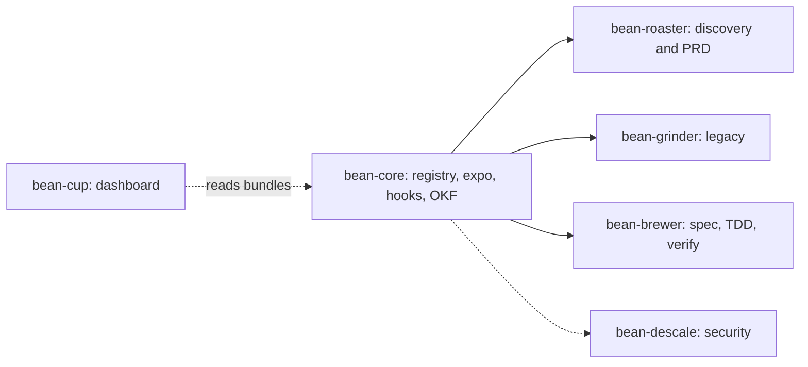

# ☕ Bean-Core

> **Canonical Stage Registry, Master Expo Orchestrator, Cross-Cutting Governance & Provenance Engine** for the Antigravity Specialty Coffee Swarm.

[](https://github.com/sapientcoffee/bean-core/actions/workflows/pages.yml)

**📖 Docs:** [**Interactive architecture explorer**](https://sapientcoffee.github.io/bean-core/) · [Architecture deep-dive (Markdown)](docs/ARCHITECTURE.md) · [**End-to-end demo (`demo.md`)**](demo.md)

---

## 🧭 Explore the architecture interactively

[`docs/index.html`](docs/index.html) is a single self-contained page. It has no build step and makes no network calls. It has five views, and you can drill from the big picture down to individual functions:

| View | What you can do |
| :--- | :--- |
| **Overview** | See the swarm map and bean-core's seven layers. Click any node to drill in. |
| **Pipeline** | Pick a cup size and an origin to see the computed stage path and its gate. Open any stage for its plugin, skill, artifact and `okf.py stamp` command. |
| **Internals** | Browse a filterable component tree (press `/` to search). Each function links to its exact line range on GitHub. |
| **Flows** | Step through sequence diagrams for the order lifecycle, SessionStart, PreToolUse, PostToolUse, `okf stamp`, council and retro (use ← / →). |
| **Playground** | Test commands against the git guardrails, try the council consensus calculator, and build `okf.py stamp` commands. |

Every view has its own URL, so you can link to it directly. For example, [`#flows/pre-tool-use`](https://sapientcoffee.github.io/bean-core/#flows/pre-tool-use) opens the guardrail flow.

**Live site:** <https://sapientcoffee.github.io/bean-core/>. The [`pages.yml`](.github/workflows/pages.yml) workflow publishes it on every push to `main` that touches `docs/`, `stages.yaml`, `scripts/` or `tests/`. The test suite, including the docs drift check, must pass before anything is deployed. Pull requests run the checks without deploying.

```bash
# Open locally (no server needed)
xdg-open docs/index.html        # macOS: open docs/index.html
```

<details>
<summary>Enabling Pages on a fork</summary>

1. Go to **Settings → Pages → Build and deployment → Source** and choose **GitHub Actions**.
   You can do the same from the CLI with `gh api -X POST repos/<owner>/bean-core/pages -f build_type=workflow`.
2. Push to `main`, or run the **Docs (GitHub Pages)** workflow by hand from the Actions tab.

</details>

---

## 🏛️ What bean-core is

bean-core is the shared foundation that the other bean plugins build on:

1. **Canonical Stage Registry ([`stages.yaml`](stages.yaml)).** Maps cup sizes and origins to pipeline stages, owning plugins, skills, artifacts and OKF types.
2. **Master Barista Orchestrator ([`@expo`](agents/expo.md)).** The stateless expediter at the pass (`mainAgent: true`). It never writes application code. It delegates discovery, specification, coding and verification to fresh subagents so context stays inside the **Smart Zone** (< 100K tokens).
3. **Cross-cutting agents.** [`@threat-modeler`](agents/threat-modeler.md) handles ASVS Level 2 threat modelling. [`@review-arbiter`](agents/review-arbiter.md) handles council consensus scoring and trade-off reconciliation.
4. **Skills.** [`triage`](skills/triage/SKILL.md) is Stage 0 (cup size × origin classification). [`retro`](skills/retro/SKILL.md) is Stage 9 (Backflush retrospective).
5. **Lifecycle hooks ([`hooks.json`](hooks.json)).** Session rehydration, destructive-git guardrails and advisory OKF validation.
6. **Open Knowledge Format v0.2 tooling ([`scripts/okf.py`](scripts/okf.py)).** Deterministic provenance stamping, `stages_completed` audit pairs and SHA-256 source hashing.



---

## 🚀 Quick start

```bash
git clone https://github.com/sapientcoffee/bean-core.git
cd bean-core
./install.sh          # copies the plugin into ~/.gemini/config/plugins/bean-core
```

`install.sh` **copies** files, so re-run it after every change. During development you can symlink the repository instead:

```bash
ln -sfn "$PWD" ~/.gemini/config/plugins/bean-core
```

**Requirements:** Python 3.10+. PyYAML is optional for `okf.py` (it has a fallback frontmatter parser) but required to run the test suite.

👉 **Want to see a full greenfield build from start to finish?** Walk through [**`demo.md`**](demo.md) to brew **"Depresso-Meter"** step-by-step in both **Antigravity 2.0** and the **Antigravity CLI (`agy`)**.

---

## 🗺️ The pipeline

Every request is classified on two axes by the `triage` skill.

| Cup size | When | Stages | Gate |
| :--- | :--- | :--- | :--- |
| ☕ **ristretto** | ≤ 2 files, clear scope | `0_triage` → `7_tdd` → `8_verify` | `direct_commit` |
| 🥛 **cortado** | Single session, ≤ 4 slices | All 11 stages, `0_triage` → `9_retro` | `artifact_gate` (RequestFeedback artifact) |
| 🫖 **carafe** | Multi-session or high blast radius | All 11 stages, `0_triage` → `9_retro` | `spec_pr` (Spec PR plus GitHub Sub-Issues) |

| Origin | Entry stage | Plugin |
| :--- | :--- | :--- |
| greenfield | `0_ideation` | bean-roaster |
| brownfield | `1_questions` | bean-roaster |
| legacy | `1_assess` | bean-grinder |

| # | Stage | Coffee name | Plugin | Artifact |
| :--- | :--- | :--- | :--- | :--- |
| 0 | `0_triage` | Order Triage | bean-core | `index.md` |
| 0 | `0_ideation` | Green Bean Selection | bean-roaster | `00_IDEATION.md` |
| 1 | `1_questions` | Cupping Form | bean-roaster | `01_QUESTIONS.md` |
| 2 | `2_blind_research` | Blind Cupping | bean-brewer | `02_EXTRACTION.md` |
| 3 | `3_grill_and_prd` | Dial-In | bean-roaster | `03_PRD.md` |
| 4 | `4_spec` | Recipe Card (Spec) | bean-brewer | `04_SPEC.md` |
| 5 | `5_plan` | Recipe Card (Vertical Slices) | bean-brewer | `05_PLAN.md` |
| 6A | `6a_council` | Q-Grader Panel | bean-brewer | `06_COUNCIL.md` |
| 6B | `6b_promote` | Calling the Order | bean-brewer | `tickets/index.md` |
| 7 | `7_tdd` | Group Heads | bean-brewer | Code and tests (≤ 3 parallel workers) |
| 8 | `8_verify` | Tasting at the Pass | bean-brewer | `07_VERIFICATION.md`, `06_WALKTHROUGH.md` |
| 9 | `9_retro` | Backflush | bean-core | `08_RETRO.md` |

See it computed live in the [Pipeline view](https://sapientcoffee.github.io/bean-core/#pipeline).

---

## 🧩 Components

### Agents

| Agent | Role |
| :--- | :--- |
| [`@expo`](agents/expo.md) | Head Barista orchestrator. Reads `stages.yaml`, triages, delegates and gates. Writes no application code. |
| [`@threat-modeler`](agents/threat-modeler.md) | Security boundary review for PRD, spec and council stages (ASVS L2). |
| [`@review-arbiter`](agents/review-arbiter.md) | Scores council rounds with `max(0, 100 − 25C − 10H − 3M − 1L)`. A round converges at ≥ 90 with no Critical or High findings, and the circuit breaker trips at round 3. |

### Hooks ([`hooks.json`](hooks.json))

| Event | Script | Behaviour |
| :--- | :--- | :--- |
| `SessionStart` | `rehydrate.py` | Scans `.scratch/*/index.md` and injects a system message that lists active bundles, their stages and artifacts. |
| `PreToolUse` (`run_command`) | `git_guardrails.py` | **Denies** force push (unless `--force-with-lease`), `reset --hard`, `clean -f` (unless `-n`/`--dry-run`), and `branch -D main\|master`. Each segment of a compound command is checked separately. |
| `PostToolUse` (file writes) | `okf.py validate .scratch` | Advisory validation only. It never blocks. |

### Scripts

```bash
# OKF bundles
python3 scripts/okf.py init-bundle .scratch/<id> --id <id> --description "..."
python3 scripts/okf.py stamp .scratch/<id>/04_SPEC.md --type specification --stage 4_spec \
    --by bean-brewer/to-spec --source 03_PRD.md
python3 scripts/okf.py validate .scratch/<id> --require-stages

# Session rehydration (what the SessionStart hook runs)
python3 scripts/rehydrate.py --workspace .

# Guardrail check (reads a hook payload on stdin)
echo '{"command": "git status"}' | python3 scripts/git_guardrails.py

# Backflush retrospective
python3 scripts/retro.py --transcript path/to/transcript.jsonl --bundle-dir plans/<id>
```

`scripts/okf_stamp.py` and `scripts/validate_okf.py` are legacy predecessors of `okf.py` and are kept for compatibility.

---

## 📐 OKF v0.2 invariants

- **Deterministic stamping.** Never hand-write timestamps, SHA-256 hashes or `stages_completed`. Use `okf.py init-bundle` and `okf.py stamp`.
- **Filename parity.** Frontmatter `id` must equal the filename stem (`04_SPEC.md` → `id: 04_SPEC`). The exception is the root `index.md`, which uses `type: bundle`.
- **Relative paths only.** `sources`, `inputs`, `outputs` and `related_tables` must not start with `/`.

The [architecture doc](docs/ARCHITECTURE.md#5-okf-v02-bundles-and-frontmatter) includes a full frontmatter example.

---

## 📁 Repository layout

```text
bean-core/
├── plugin.json            # Plugin manifest
├── stages.yaml            # Canonical stage registry
├── hooks.json             # SessionStart / PreToolUse / PostToolUse wiring
├── install.sh             # Copy-based installer
├── demo.md                # End-to-end walkthrough (Antigravity 2.0 & agy CLI)
├── agents/                # expo, threat-modeler, review-arbiter
├── skills/                # triage (Stage 0), retro (Stage 9)
├── rules/AGENTS.md        # Always-on governance rules
├── scripts/               # okf.py, rehydrate.py, git_guardrails.py, retro.py (+ legacy)
├── evals/                 # Evidence samples
├── docs/
│   ├── index.html         # Interactive architecture explorer
│   └── ARCHITECTURE.md    # Markdown deep-dive with mermaid diagrams
└── tests/                 # test_okf.py, test_docs.py
```

---

## 📋 Catalog of plugins

| Plugin | Theme / role | Key stages | Output artifacts |
| :--- | :--- | :--- | :--- |
| **bean-core** | **The Roastery Hub** (registry, orchestration and governance) | Stage 0 (Triage), cross-cutting review, Stage 9 (Retro) | `stages.yaml`, `index.md`, `08_RETRO.md` |
| **bean-roaster** | **The Roaster** (product discovery and Socratic PRD) | Stage 0 (Ideation), Stage 1 (Cupping Form), Stage 3 (PRD) | `00_IDEATION.md`, `01_QUESTIONS.md`, `03_PRD.md` |
| **bean-grinder** | **The Grinder** (legacy modernisation and AST analysis) | Legacy assessment, seam extraction, migration planning | `05_PLAN.md` (modernisation slices) |
| **bean-brewer** | **The Brewer** (implementation, Spec PR and TDD forge) | Stages 2, 4, 5, 6A/6B, 7, 8 | `02_EXTRACTION.md`, `04_SPEC.md`, `05_PLAN.md`, `06_COUNCIL.md`, `06_WALKTHROUGH.md`, `07_VERIFICATION.md` |
| **bean-descale** | **The Descaler** (security operations and harness immunity) | Security remediation, attack trees, harness gotchas | `attack_tree.md`, `.agents/rules/gotchas/` |
| **bean-cup** | **The Cup** (visual dashboard, kanban tracker and workflow state scanner) | Reads bundle state across stages | Dashboard views |

---

## 🛠️ Verification & testing

```bash
pip install pyyaml
python3 -m unittest discover -s tests -v
```

| Suite | Covers |
| :--- | :--- |
| `tests/test_okf.py` | OKF stamping, validation, rehydration, guardrails, retro and schema checks |
| `tests/test_docs.py` | Checks that `docs/index.html` still matches the code: stage, cup-size and origin data against `stages.yaml`, every function line reference against the actual `def`, and every script appearing in the docs |

If you change `stages.yaml` or move a function, `test_docs.py` fails until you update the explorer.

---

## ⚠️ Known gaps

Building the docs turned up a few inconsistencies. One example is that stamping `index.md` overwrites the bundle `id`. Another is that `1_assess` is referenced but never defined in `stages.yaml`. The full list is in [ARCHITECTURE.md § Known gaps](docs/ARCHITECTURE.md#9-known-gaps) and in the explorer under **Internals → Known gaps**.

---

## 📄 License

Apache-2.0. See [`plugin.json`](plugin.json).
