# ☕ End-to-End Demo: Building "Depresso-Meter" (Antigravity 2.0 & CLI)

> **A complete step-by-step walkthrough from an empty directory to a tested, verified Pull Request using the Antigravity Specialty Coffee Swarm (`bean-core`, `bean-roaster`, and `bean-brewer`).**

⬅️ [Back to `README.md`](README.md) · 🧭 [Interactive Architecture Explorer](https://sapientcoffee.github.io/bean-core/) · 📐 [Architecture Deep-Dive](docs/ARCHITECTURE.md)

---

## 🎯 The Feature We’re Brewing: "Depresso-Meter"

**Concept:** A single-page greenfield web app where developers log their daily espresso shots, track their real-time **"Jitter-to-Commit Ratio"** on a live gauge, and get judged by **"Luigi," a snarky virtual Italian Barista** who refuses to serve cappuccinos after 11:00 AM and publicly shames anyone who clicks the *"Request Decaf"* button.

| Triage Axis | Value | Why |
| :--- | :--- | :--- |
| **Origin** | `greenfield` | Brand-new repository; starts at Stage `0_ideation` (`bean-roaster`). |
| **Cup Size** | `cortado` | Single-session web app (~4 files, ≤ 3 vertical slices) with an interactive `artifact_gate`. |
| **Bundle ID** | `depresso-01` | Tracked in `.scratch/depresso-01/` during execution and archived to `plans/depresso-01/`. |

```mermaid
flowchart LR
    Triage["0_triage<br/>index.md"] --> Ideation["0_ideation<br/>00_IDEATION.md"]
    Ideation --> Questions["1_questions<br/>01_QUESTIONS.md"]
    Questions --> Research["2_blind_research<br/>02_EXTRACTION.md"]
    Research --> PRD["3_grill_and_prd<br/>03_PRD.md"]
    PRD --> Spec["4_spec<br/>04_SPEC.md + contracts/"]
    Spec --> Plan["5_plan<br/>05_PLAN.md"]
    Plan --> Council["6a_council<br/>06_COUNCIL.md"]
    Council --> Promote["6b_promote<br/>tickets/index.md"]
    Promote --> TDD["7_tdd<br/>3x Group Head Slices"]
    TDD --> Verify["8_verify<br/>07_VERIFICATION.md + 06_WALKTHROUGH.md"]
    Verify --> Retro["9_retro<br/>08_RETRO.md"]
```



---

## 0. One-Time Prerequisites & Blank Repo Setup (Both Surfaces)

1. **Install the Specialty Coffee Swarm plugins** so both **Antigravity 2.0** and the **Antigravity CLI (`agy`)** load the governance rules ([`rules/AGENTS.md`](rules/AGENTS.md)), lifecycle hooks ([`hooks.json`](hooks.json)), skills, and subagents:

   ```bash
   # From each plugin repository
   ./bean-core/install.sh
   ./bean-roaster/install.sh
   ./bean-brewer/install.sh
   ```

2. **Create a fresh Git repository** for the demo web app:

   ```bash
   mkdir -p ~/workspace/depresso-meter
   cd ~/workspace/depresso-meter
   git init -b main
   git commit --allow-empty -m "chore: initial empty roast"
   ```

---

## 🖥️ Track A: Step-by-Step in Antigravity 2.0 (Desktop App)

### Step 1: Open the Project & Configure Permissions
1. Launch **Antigravity 2.0**, open **Projects** in the left-hand sidebar, and add `~/workspace/depresso-meter`.
2. In **Settings**, verify:
   * **Tool Execution Policy**: `proceed-in-sandbox`
   * **Artifact Review Mode**: `asks-for-review` (so the Cortado gate presents an interactive **Proceed** button before coding begins)
3. Click **New Conversation**. The `SessionStart` hook ([`scripts/rehydrate.py`](scripts/rehydrate.py)) runs automatically to check for any existing `.scratch/*/index.md` bundles.

### Step 2: Stage 0 — Order Triage & Green Bean Selection (`0_triage` → `0_ideation`)
Paste the following prompt into the **Chat Canvas**:

```text
Let's build a greenfield web app called "Depresso-Meter" (bundle id: depresso-01) — a hilarious caffeine tracker for developers.
Features:
1. Log espresso shots ("Ristretto of Regret", "Double Shot of Panic", "3 AM Prod-Fix Cold Brew").
2. A live "Jitter-to-Commit Ratio" gauge that vibrates using CSS keyframes once you pass 400mg of caffeine.
3. A snarky Italian Barista banner ("Luigi") that insults you if you order a Cappuccino after 11 AM or click "Decaf".
Triage this order and start greenfield ideation!
```

* **What happens behind the scenes:**
  1. [`@expo`](agents/expo.md) runs the [`triage`](skills/triage/SKILL.md) skill, classifies the request as **`cortado` × `greenfield`**, and initializes `.scratch/depresso-01/index.md` via [`scripts/okf.py`](scripts/okf.py).
  2. `@expo` dispatches `@product-ideator` (`bean-roaster`). You can watch the subagent work live in **Auxiliary Pane → Subagents**.
  3. `@product-ideator` writes `.scratch/depresso-01/00_IDEATION.md` with personas (*"On-Call Owen, vibrating at 140 BPM"*), Critical User Journeys (CUJs), and draft JSON schemas.

### Step 3: Stages 1 & 2 — Cupping Form & Blind Cupping (`1_questions` → `2_blind_research`)
1. `@expo` invokes `@question-formulator` (`cupping-form` skill) to write `.scratch/depresso-01/01_QUESTIONS.md` with **zero feature solution leakage**.
2. `@expo` runs Stage 2 Blind Cupping (`research` skill), dispatching read-only scouts (`@codebase-analysis`, `@context-mapping`) that read *only* `01_QUESTIONS.md`.
3. `@extraction-synthesizer` compiles their findings into `.scratch/depresso-01/02_EXTRACTION.md` (confirming a clean greenfield repository) and stamps OKF provenance.

### Step 4: Stage 3 — Dial-In Socratic Grill & PRD (`3_grill_and_prd`)
1. Using the `grill` skill, the agent displays interactive multiple-choice cards in the **Chat Canvas**:
   * **Question 1:** *"What happens when a developer clicks the 'Request Decaf' button?"*
     * `[x] (Recommended) Trigger a record-scratch visual alert, reset Street Cred to 0, and lock the UI in 'Dishonor Mode' for 5 seconds`
     * `[ ] Silently log 0mg of caffeine`
   * **Question 2:** *"Where should daily caffeine intake be persisted?"*
     * `[x] (Recommended) Browser localStorage with midnight auto-flush`
     * `[ ] In-memory session state only`
2. Click your choices and submit *(or type `/grill-me` in the Chat Canvas if you want to explore edge cases further)*.
3. `@expo` orchestrates `@prd-author`, `@copy-editor`, and [`@threat-modeler`](agents/threat-modeler.md) (`write-prd` skill) to produce `.scratch/depresso-01/03_PRD.md` (with numbered `AC1..AC4`) and `evals/test_kpis.py`.
4. Reply in the Chat Canvas:
   > *"PRD approved! Proceed to Stage 4 Spec and Stage 5 Plan."*

### Step 5: Stages 4, 5 & 6A — Recipe Card Spec, Vertical Slices & Q-Grader Council (`4_spec` → `6a_council`)
1. `@expo` delegates to `@system-design` (`to-spec` and `to-tickets` skills) to generate:
   * `contracts/caffeine_state.schema.json` — Physical JSON schema for shot logs, caffeine total, and Luigi’s roast state.
   * `.scratch/depresso-01/04_SPEC.md` — Module boundaries and numbered test seams (`SEAM-01`: Caffeine math & 400mg jitter threshold; `SEAM-02`: Luigi’s 11 AM Cappuccino & Decaf rule engine; `SEAM-03`: DOM & `localStorage` sync) with zero brittle file paths.
   * `.scratch/depresso-01/05_PLAN.md` — 3 tracer-bullet vertical slices:
     * **Slice 1 `[AFK]`**: Core Caffeine & Luigi Shaming Engine (`Covers: AC1, AC2`)
     * **Slice 2 `[AFK]`**: Interactive Web UI, CSS `@keyframes` Jitter Gauge & `localStorage` (`Covers: AC3`)
     * **Slice 3 `[AFK]`**: Decaf "Dishonor Mode" Easter Egg & Accessibility Check (`Covers: AC4`)
2. `@expo` runs `scripts/plan_lint.py` and convenes the Q-Grader Council (`@contract-auditor`, `@code-inspection`, `@reviewer-product`, [`@review-arbiter`](agents/review-arbiter.md)), emitting `.scratch/depresso-01/06_COUNCIL.md` (`Score: 97/100 — PASS`).
3. **Cortado Approval Gate:** Open the **Artifacts** tab in the Auxiliary Pane, review the plan, and click **Proceed**.

### Step 6: Stage 7 — Parallel Group Head TDD Execution (`7_tdd`)
1. `@expo` runs `promote.py --offline` (creating `.scratch/depresso-01/tickets/index.md`) and provisions **The Pass** (`epic/depresso-01-caffeine-tracker`) plus isolated worktrees (`.worktrees/task-depresso-01-slice-1/`, etc.).
2. `@code-implementation` Group Heads execute **Red → Green → Refactor** for each slice:
   * Write failing tests first (e.g., asserting that ordering a Cappuccino at `11:01` returns `"Mamma mia! Are you a toddler? Take an espresso!"`).
   * Implement `index.html`, `styles.css`, and `app.js`.
   * Run `code-hygiene` static checks and create **one atomic Conventional Commit per slice** before merging back into `epic/depresso-01-caffeine-tracker`.
3. Inspect the live diffs at any time in **Auxiliary Pane → Files Changed**.

### Step 7: Stages 8 & 9 — Tasting at the Pass, Walkthrough & Backflush (`8_verify` → `9_retro`)
1. **Velocity Reaper (`@execution-verifier`)**: Runs the full test suite, verifies exit code `0`, checks that every `AC1..AC4` maps to a passing test with zero `.skip`/`xit` bypasses, and stamps `07_VERIFICATION.md`.
2. **Walkthrough (`@walkthrough-recorder`)**: Runs `record` (and optionally captures browser screenshots via Chrome DevTools MCP `/browser`) into `plans/depresso-01/06_WALKTHROUGH.md`.
3. **Delivery & Backflush Retro**:
   * `git-delivery` merges `epic/depresso-01-caffeine-tracker` (or opens a "What, Why, How" GitHub PR).
   * [`scripts/retro.py`](scripts/retro.py) ([`retro`](skills/retro/SKILL.md) skill) mines `transcript.jsonl` into `plans/depresso-01/08_RETRO.md` to verify Smart Zone compliance (< 100K tokens).
   * `archive` moves spent artifacts into `./plans/` and `motivate` closes out with a celebratory coffee pun.

---

## ⌨️ Track B: Step-by-Step in Antigravity CLI (`agy`)

You can run the exact same **Depresso-Meter** greenfield workflow entirely from your terminal using `agy`.

### Step 1: Launch `agy` in the Repository
```bash
cd ~/workspace/depresso-meter
agy
```
* On startup, the `SessionStart` hook runs [`scripts/rehydrate.py`](scripts/rehydrate.py).
* Type `/help` at any time to see built-in CLI slash commands.

### Step 2: Stage 0 — Triage & Greenfield Ideation
At the `agy` prompt, enter:

```text
> Use the triage and ideator skills for a greenfield cortado web app called "Depresso-Meter" (bundle id: depresso-01). It tracks developer espresso shots, vibrates the UI above 400mg of caffeine, and features "Luigi", a snarky Italian barista who roasts you if you order a Cappuccino after 11 AM or click Decaf.
```

* `agy` initializes `.scratch/depresso-01/index.md` via [`scripts/okf.py`](scripts/okf.py) and delegates to `@product-ideator` to author `.scratch/depresso-01/00_IDEATION.md`.

### Step 3: Stages 1–3 — Cupping Form, Blind Research, Grill & PRD
1. Kick off the discovery and interview stages:
   ```text
   > Run cupping-form, research, and grill for depresso-01.
   ```
2. `@question-formulator` writes `.scratch/depresso-01/01_QUESTIONS.md`, and the Blind Cupping scouts + `@extraction-synthesizer` produce `.scratch/depresso-01/02_EXTRACTION.md`.
3. When `agy` renders the interactive multiple-choice `ask_question` prompts in the terminal TUI (for Luigi’s Decaf punishment and `localStorage` persistence), use the **Up/Down arrow keys** and press **`Enter`**.
4. Generate and audit the PRD:
   ```text
   > Run write-prd for depresso-01.
   ```
   `@prd-author`, `@copy-editor`, and [`@threat-modeler`](agents/threat-modeler.md) emit `.scratch/depresso-01/03_PRD.md` and `evals/test_kpis.py`.

### Step 4: Stages 4–6A — Spec, Vertical Slices & Q-Grader Council
Approve the PRD and advance through specification and council linting:

```text
> PRD approved! Run to-spec, to-tickets, and plan-council for depresso-01.
```

* `@system-design` creates `contracts/caffeine_state.schema.json`, `.scratch/depresso-01/04_SPEC.md`, and `.scratch/depresso-01/05_PLAN.md`.
* `agy` runs `plan_lint.py` and the council swarm to stamp `.scratch/depresso-01/06_COUNCIL.md`.
* *(Optional)* Verify OKF bundle provenance directly from your shell:
  ```bash
  python3 ~/.gemini/config/plugins/bean-core/scripts/okf.py validate .scratch/depresso-01 --require-stages
  ```

### Step 5: Stages 6B & 7 — Promote & Autonomous Group Head TDD
Use the `/goal` command in `agy` so the agent works autonomously through all three TDD slices and verification:

```text
> /goal Approved! Promote depresso-01 (--offline), execute all 3 slices in .scratch/depresso-01/05_PLAN.md using isolated worktrees and @code-implementation Group Heads, and verify with @execution-verifier.
```

* `agy` promotes the slices to `.scratch/depresso-01/tickets/index.md`, creates branch `epic/depresso-01-caffeine-tracker`, runs `@code-implementation` in isolated `.worktrees/task-depresso-01-*/` directories, executes `code-hygiene`, and lands 3 atomic Conventional Commits on **The Pass**.

### Step 6: Stages 8 & 9 — Walkthrough, Git Delivery & Backflush Retro
Wrap up the release and generate the retrospective:

```text
> Run record to generate plans/depresso-01/06_WALKTHROUGH.md, deliver epic/depresso-01-caffeine-tracker via git-delivery, run retro, and finish with motivate!
```

* `@walkthrough-recorder` records terminal proof into `plans/depresso-01/06_WALKTHROUGH.md`.
* `git-delivery` merges `epic/depresso-01-caffeine-tracker` into `main` (or opens a GitHub PR via `gh pr create`).
* [`scripts/retro.py`](scripts/retro.py) writes `plans/depresso-01/08_RETRO.md`.
* Open your new web app locally:
  ```bash
  xdg-open index.html        # macOS: open index.html
  ```
* Exit `agy` with `/exit` (or `Ctrl+D Ctrl+D`).

---

## 🔄 Quick Comparison: Antigravity 2.0 vs. CLI (`agy`)

| Workflow Step | Antigravity 2.0 (Desktop App) | Antigravity CLI (`agy`) |
| :--- | :--- | :--- |
| **Start Session** | Click **New Conversation** in Left Sidebar | Run `agy` inside project directory |
| **Attach Files / Context** | Type `@` in Chat Canvas or drag-and-drop media | Type `@path/to/file` in TUI prompt |
| **Monitor Subagents** | **Auxiliary Pane → Subagents** live view | Inline TUI status spinners & completion summaries |
| **Answer `grill` Prompts** | Click options in interactive UI card | Arrow keys + `Enter` in TUI selector |
| **Approve Cortado Gate** | Click **Proceed** button in **Artifacts** pane | Reply `Approved, proceed` in TUI prompt |
| **Inspect Code Diffs** | **Auxiliary Pane → Files Changed** diff viewer | Run `git diff` in terminal |
| **Multi-Slice Execution** | Use `/goal` or `/teamwork` in Chat Canvas | Use `/goal` or `/teamwork` in TUI |
