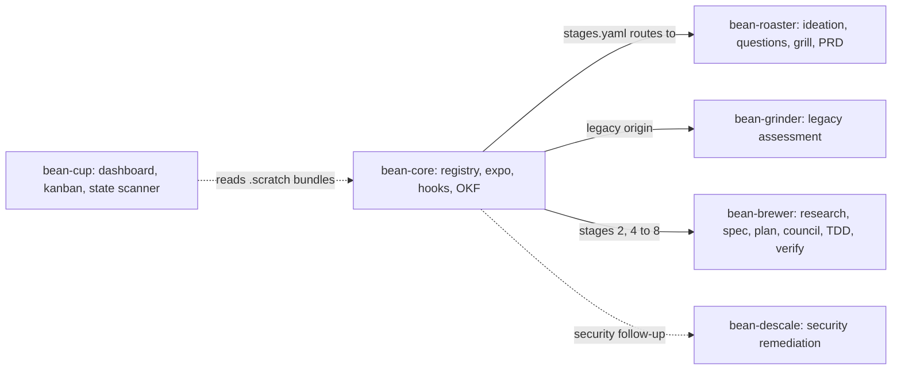
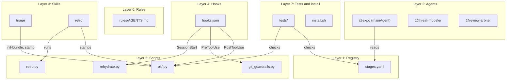
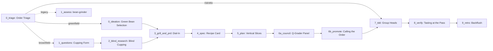
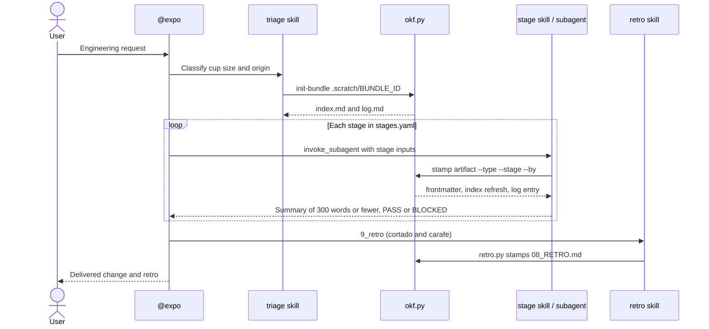
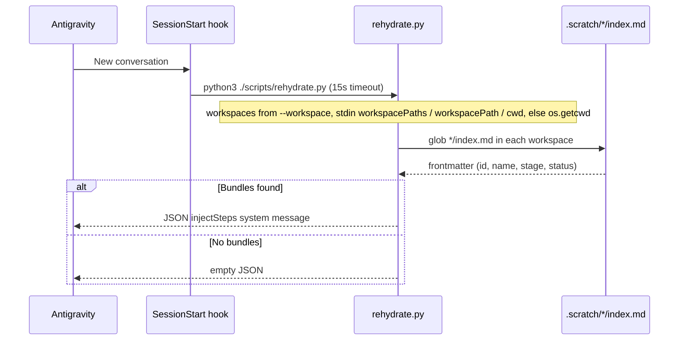
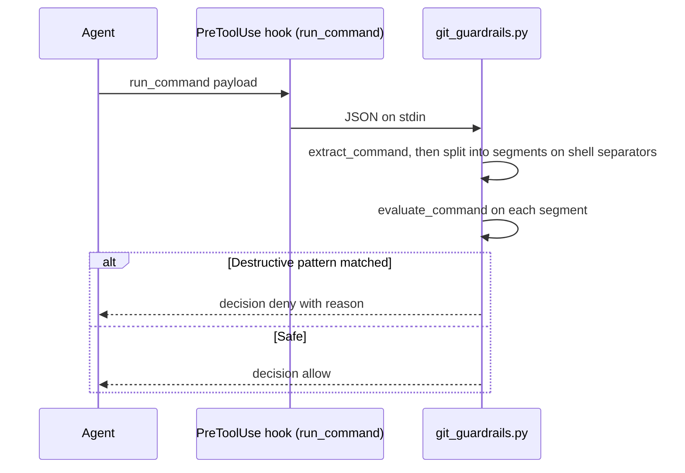
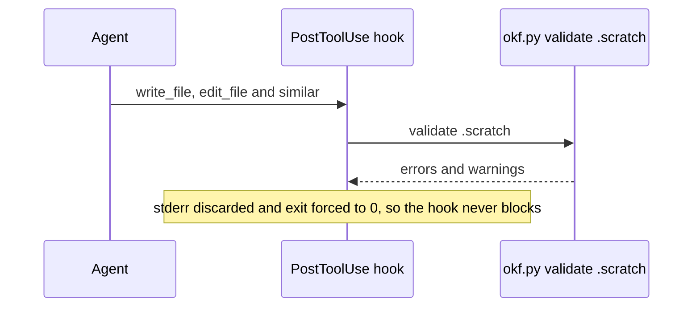
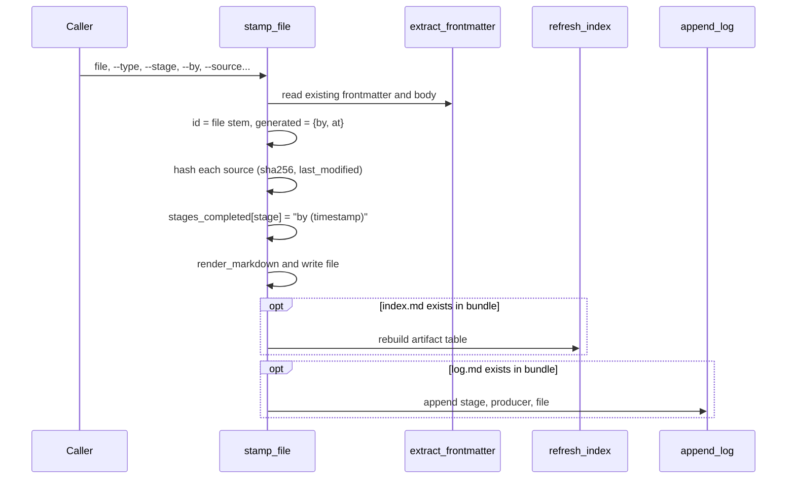
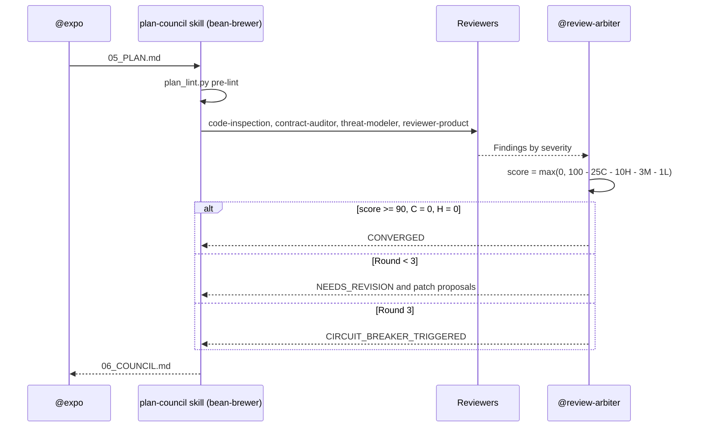
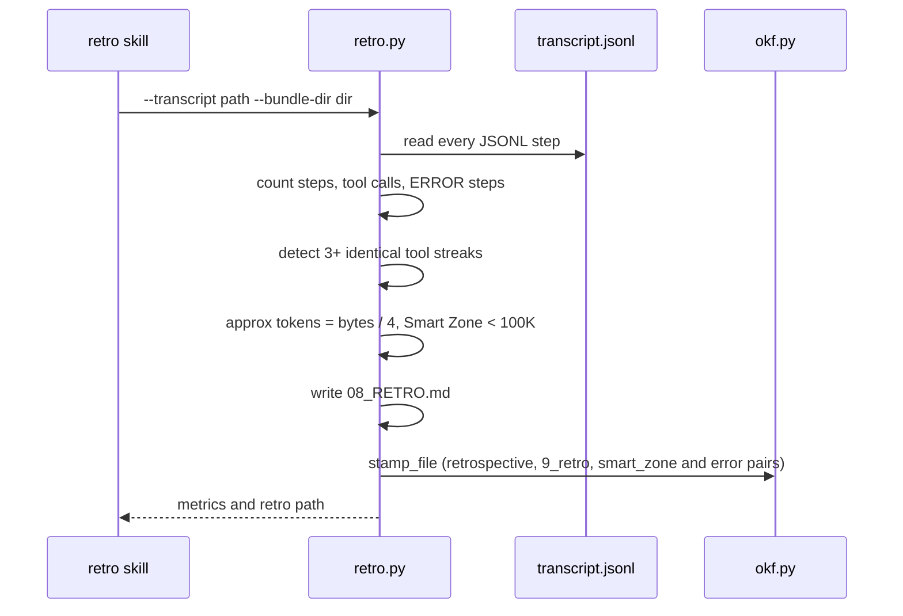

# ☕ Bean-Core Architecture

> The plain-Markdown companion to the **[interactive architecture explorer](index.html)**.
> The explorer lets you drill from the swarm overview down to individual functions and step through each runtime flow.
> This document covers the same material in a form that renders on GitHub.

**Contents**

1. [Where bean-core sits in the swarm](#1-where-bean-core-sits-in-the-swarm)
2. [Component layers](#2-component-layers)
3. [The pipeline: cup sizes, origins and gates](#3-the-pipeline-cup-sizes-origins-and-gates)
4. [Runtime flows](#4-runtime-flows)
5. [OKF v0.2 bundles and frontmatter](#5-okf-v02-bundles-and-frontmatter)
6. [Git guardrails](#6-git-guardrails)
7. [Council consensus](#7-council-consensus)
8. [Script and function reference](#8-script-and-function-reference)
9. [Known gaps](#9-known-gaps)

---

## 1. Where bean-core sits in the swarm

bean-core is the shared hub of the Antigravity Specialty Coffee Swarm. It owns the stage registry, the orchestrator persona, the lifecycle hooks and the OKF tooling. The other plugins provide the stage skills.



| Plugin | Role | Stages it owns |
| :--- | :--- | :--- |
| **bean-core** | Registry, orchestration, governance | `0_triage`, `9_retro`, cross-cutting agents |
| **bean-roaster** | Product discovery and PRD | `0_ideation`, `1_questions`, `3_grill_and_prd` |
| **bean-grinder** | Legacy modernisation | `1_assess` (legacy entry, see [gap 3](#9-known-gaps)) |
| **bean-brewer** | Spec, slices, council and TDD | `2_blind_research`, `4_spec`, `5_plan`, `6a_council`, `6b_promote`, `7_tdd`, `8_verify` |
| **bean-descale** | Security operations | Attack trees, remediation, harness gotchas |
| **bean-cup** | Visual dashboard | Reads bundle state; owns no stage |

---

## 2. Component layers



| Layer | Files | Purpose |
| :--- | :--- | :--- |
| Registry | `stages.yaml` | Canonical map of cup sizes, origins and stages (plugin, skill, artifact, OKF type, next stages). |
| Agents | `agents/expo.md`, `agents/threat-modeler.md`, `agents/review-arbiter.md` | `@expo` is the stateless orchestrator. It delegates all work to subagents to stay inside the Smart Zone (< 100K tokens). The other two are cross-cutting reviewers. |
| Skills | `skills/triage/SKILL.md`, `skills/retro/SKILL.md` | Stage 0 classification and Stage 9 retrospective. |
| Hooks | `hooks.json` | Wires the scripts into `SessionStart`, `PreToolUse` and `PostToolUse`. |
| Scripts | `scripts/*.py` | Deterministic, standard-library Python (PyYAML optional) for OKF stamping, validation, rehydration, guardrails and retros. |
| Rules | `rules/AGENTS.md` | Always-on governance loaded into every conversation. |
| Tests and install | `tests/`, `install.sh` | Unit tests and a copy-based installer. |

---

## 3. The pipeline: cup sizes, origins and gates

Every request is classified on two axes: **cup size** (how big) and **origin** (where it starts).

| Cup size | Scope | Stages | Gate |
| :--- | :--- | :--- | :--- |
| `ristretto` | ≤ 2 files, clear requirements | `0_triage` → `7_tdd` → `8_verify` | `direct_commit` |
| `cortado` | Single-session feature, ≤ 4 slices | All 11 stages | `artifact_gate` (RequestFeedback artifact) |
| `carafe` | Multi-session epic or high blast radius | All 11 stages | `spec_pr` (Spec PR plus GitHub Sub-Issues) |

| Origin | Entry stage | Plugin |
| :--- | :--- | :--- |
| `greenfield` | `0_ideation` | bean-roaster |
| `brownfield` | `1_questions` | bean-roaster |
| `legacy` | `1_assess` | bean-grinder |



Notes:

- `1_assess` is referenced by `origins.legacy` and `0_triage.next` but has no entry under `stages:`. The diagram draws it dashed.
- Greenfield skips `1_questions` and `2_blind_research`, because `0_ideation.next` is `3_grill_and_prd`.
- Stages `0` to `6b` write to the ephemeral bundle (`.scratch/<id>/`). Stages `8` and `9` write to durable plans (`plans/`).
- `7_tdd` runs up to 3 parallel `code-implementation` workers in `share` workspace mode.

---

## 4. Runtime flows

### 4.1 Order lifecycle



### 4.2 SessionStart: rehydration



### 4.3 PreToolUse: git guardrails



### 4.4 PostToolUse: advisory validation



### 4.5 `okf.py stamp`



### 4.6 Council (Stage 6A)



### 4.7 Retro (Stage 9)



---

## 5. OKF v0.2 bundles and frontmatter

A bundle is a directory, normally `.scratch/<id>/`, containing:

| File | Role |
| :--- | :--- |
| `index.md` | Bundle root, `type: bundle`. `refresh_index` rebuilds its artifact table on every stamp. |
| `log.md` | Append-only audit log written by `append_log`. |
| `NN_*.md` | Stage artifacts. Frontmatter `id` must equal the filename stem. |

Example frontmatter produced by `okf.py stamp`:

```yaml
---
id: 04_SPEC
type: specification
name: Recipe Card
description: Recipe Card (4_spec)
status: draft
stage: 4_spec
generated:
  by: bean-brewer/to-spec
  at: 2026-11-06T17:00:00Z
sources:
  - id: 03_PRD
    resource: 03_PRD.md
    last_modified: 2026-11-06T16:40:00Z
    sha256: 9f2c...
stages_completed:
  3_grill_and_prd: bean-roaster/write-prd (2026-11-06T16:40:00Z)
  4_spec: bean-brewer/to-spec (2026-11-06T17:00:00Z)
---
```

Invariants checked by `okf.py validate`:

- **Filename parity.** `id` must match the filename stem. Only the root `index.md` is exempt, and it must have `type: bundle`.
- **`type` is required.**
- **Relative paths only.** An absolute path in `sources[].resource`, `inputs`, `outputs` or `related_tables` is an error. An unresolvable relative path is a warning.
- **With `--require-stages`.** `stages_completed` must be non-empty, and `generated` must contain both `by` and `at`.
- **Never hand-write** timestamps, hashes or `stages_completed`. Always use `okf.py init-bundle` and `okf.py stamp`.

---

## 6. Git guardrails

`scripts/git_guardrails.py` splits a command on `&&`, `||`, `;`, `|` and newlines, then checks each segment:

| Rule | Denied | Allowed |
| :--- | :--- | :--- |
| Force push | `push --force`, `push -f`, `push origin +src:dst` | `--force-with-lease`, `--force-if-includes` |
| Hard reset | `reset ... --hard` | `reset --soft`, `reset --mixed` |
| Clean | `clean -f`, `-fd`, `-fx`, `--force` | Anything with `-n` or `--dry-run` |
| Protected branch delete | `branch -D main\|master`, `branch --delete --force main\|master` | Deleting any other branch |

Global options between `git` and the subcommand (for example `git -C repo push -f`) are also caught. You can try commands in the **Playground** view of the [interactive explorer](index.html#playground). It runs a JavaScript port of `evaluate_command`.

---

## 7. Council consensus

`@review-arbiter` scores each review round:

$$\text{score} = \max(0,\ 100 - 25C - 10H - 3M - 1L)$$

| Verdict | Condition |
| :--- | :--- |
| `CONVERGED` | score ≥ 90, no Critical and no High findings |
| `NEEDS_REVISION` | score < 90, or Critical/High findings remain (up to round 3) |
| `CIRCUIT_BREAKER_TRIGGERED` | Round 3 reached without convergence; escalate to the Stage 6B human gate |

The arbiter only proposes patches. It never edits `05_PLAN.md` itself.

---

## 8. Script and function reference

All line numbers refer to `main`. The interactive explorer links each function to its line range on GitHub, and `tests/test_docs.py` fails if a referenced line stops being the matching `def`.

### `scripts/okf.py`

```bash
python3 scripts/okf.py init-bundle .scratch/<id> --id <id> --description "..."
python3 scripts/okf.py stamp <file> --type <okf_type> --stage <stage> --by <producer> \
    [--name ...] [--description ...] [--status draft|stable|deprecated] \
    [--source rel/path.md ...] [--stage-pair key=value ...] [--verified-by ...] [--bundle-dir ...]
python3 scripts/okf.py validate <bundle-or-file> [--require-stages]
```

| Function | Lines | Purpose |
| :--- | :--- | :--- |
| `extract_frontmatter` | 60–98 | Parse YAML frontmatter, using PyYAML when available and a minimal parser otherwise |
| `render_markdown` | 101–108 | Serialise frontmatter and body |
| `append_log` | 111–121 | Append an audit row to `log.md` |
| `refresh_index` | 124–160 | Rebuild the artifact table in `index.md` |
| `init_bundle` | 163–167 | Create `index.md` and `log.md` |
| `stamp_file` | 170–256 | Write deterministic OKF frontmatter |
| `validate_file` | 259–351 | Check one entity file |
| `validate_bundle` | 354–423 | Check every file in a bundle |
| `main` | 426–482 | argparse CLI |

### `scripts/rehydrate.py`

```bash
python3 scripts/rehydrate.py [--workspace <dir> ...]
```

| Function | Lines | Purpose |
| :--- | :--- | :--- |
| `parse_frontmatter` | 25–48 | Lightweight frontmatter reader |
| `find_active_bundles` | 51–85 | Glob `.scratch/*/index.md` in each workspace |
| `rehydrate_workspace` | 88–112 | Build the `injectSteps` system message |
| `main` | 115–144 | CLI and hook entry point |

### `scripts/git_guardrails.py`

```bash
echo '{"command": "git status"}' | python3 scripts/git_guardrails.py
```

| Function | Lines | Purpose |
| :--- | :--- | :--- |
| `extract_command` | 23–42 | Pull the command string out of the hook payload |
| `evaluate_command` | 45–96 | Apply the four deny rules per segment |
| `main` | 99–120 | Read stdin and print the JSON decision |

### `scripts/retro.py`

```bash
python3 scripts/retro.py --transcript <path/to/transcript.jsonl> --bundle-dir <dir> [--output 08_RETRO.md] [--json]
```

| Function | Lines | Purpose |
| :--- | :--- | :--- |
| `extract_tool_names` | 33–56 | Read tool names from a transcript step |
| `analyze_transcript` | 59–135 | Compute steps, tool counts, errors, retry streaks and token estimate |
| `generate_retro_markdown` | 138–182 | Render the report |
| `write_retro_report` | 185–216 | Write and stamp `08_RETRO.md` |
| `main` | 219–241 | CLI |

### Legacy scripts

`scripts/okf_stamp.py` and `scripts/validate_okf.py` predate `okf.py` and duplicate parts of it (`okf_stamp.py` requires PyYAML). New callers should use `okf.py`.

---

## 9. Known gaps

These issues were found while building the docs. The explorer lists them under **Internals → Known gaps**.

1. **Stamping `index.md` overwrites the bundle id.** The triage skill runs `okf.py stamp .scratch/<id>/index.md`. `stamp_file` always sets `id` to the file stem, so the bundle id becomes `index` and rehydration reports bundle `index`.
2. **The bundle `stage` never advances.** `refresh_index` keeps the existing `stage`. Only an explicit stamp of `index.md` changes it, and that triggers gap 1.
3. **`1_assess` is undefined.** It is referenced by `origins.legacy` and `0_triage.next` but has no entry in `stages:`.
4. **Hook path assumptions.** `hooks.json` calls plugin-relative `./scripts/...` but validates workspace-relative `.scratch`. PostToolUse is advisory only (`2>/dev/null || true`).
5. **Dangling agent references.** `@review-arbiter` mentions `@architect` and `@auditor`, which no plugin defines.
6. **Duplicated scripts.** `okf.py`, `git_guardrails.py` and `rehydrate.py` have byte-identical copies in bean-brewer, so they can drift apart. `rules/AGENTS.md` cites `scripts/plan_lint.py`, which lives in bean-brewer.
7. **Hard-coded test path (fixed).** `tests/test_okf.py` used to point at a machine-specific scratch directory. It now uses the repository root.
